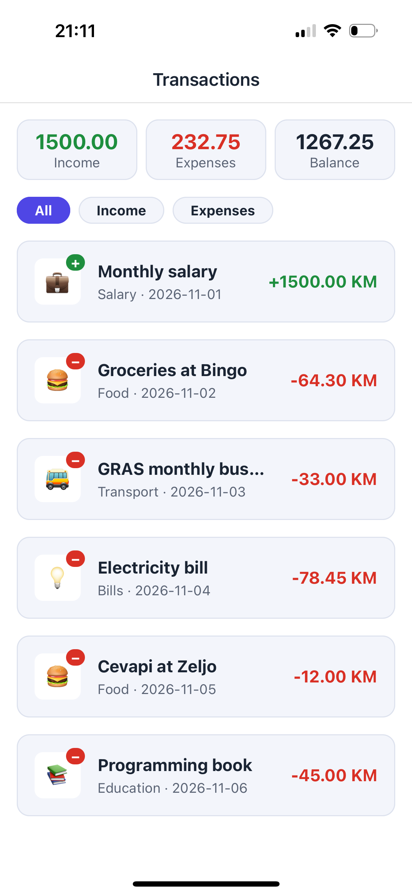
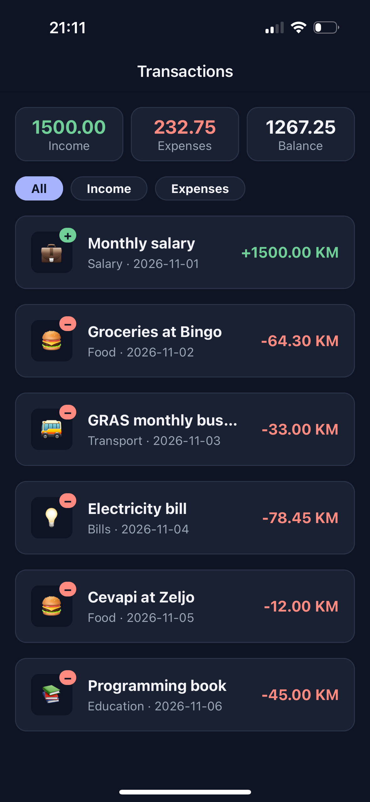

# Spendly

Spendly is a mobile app that helps users track their income and expenses, organize transactions by category, and monitor their monthly spending. Users can set a monthly budget, view spending statistics, and manage their personal financial records in one place.

Built with React Native and Expo (SDK 58) for the Cross-Platform Development course at International Burch University.

## Run the project

```bash
npm install
npx expo start
```

Then scan the QR code with the Expo Go app on your phone.

## Screenshots

| Light mode | Dark mode |
|---|---|
|  |  |

## Features

- [x] List of transactions (mock data)
- [x] Consistent styling with a light and dark theme
- [x] Summary of income, expenses and balance
- [x] Layout for phones and tablets (1, 2 or 3 columns)
- [x] Transaction list with FlatList, loading, error and empty states
- [x] Pull to refresh
- [x] Filter by income or expenses
- [x] Delete a transaction with a long press
- [ ] Transaction details screen
- [ ] Tabs and a modal
- [ ] Add and edit transactions with validation
- [ ] Monthly budget and statistics
- [ ] Settings saved on the device (currency, budget)
- [ ] Receipt photo from the gallery and haptic feedback
- [ ] Login and data storage with Supabase
- [ ] Android APK build
